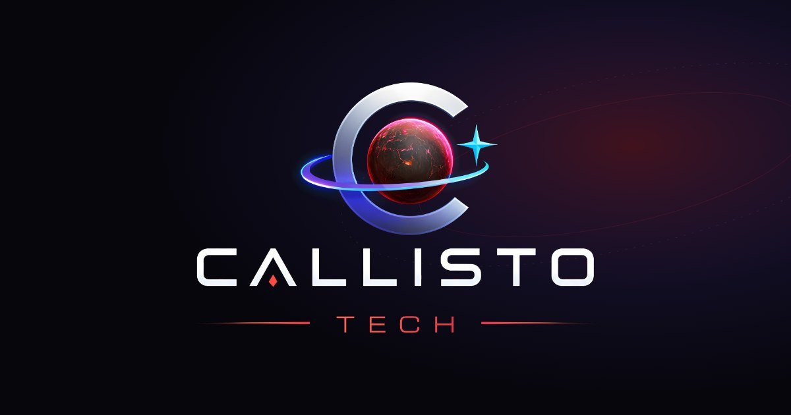
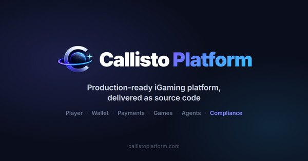
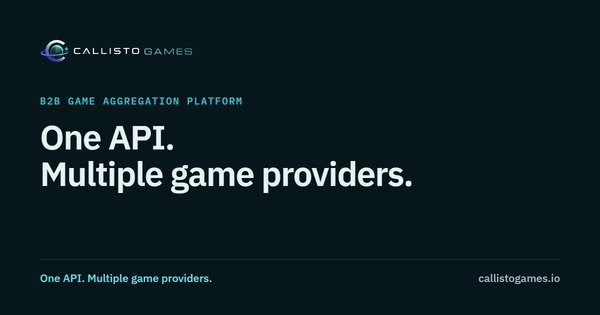
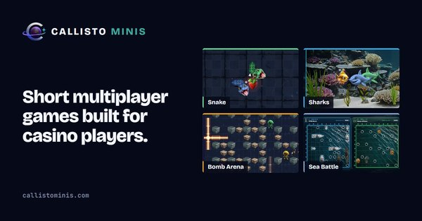

  

<h3 align="center">The technology behind gaming: an operator platform, a game aggregation network and original games.</h3>

  <a href="https://callistotech.io"><b>callistotech.io</b></a> ·
  <a href="https://callistoplatform.com">Platform</a> ·
  <a href="https://callistogames.io">Callisto Games</a> ·
  <a href="https://callistominis.com">Callisto Minis</a>

---

---

### What we build

- **[Callisto Platform](https://callistoplatform.com)** — a production-ready iGaming platform sold as full source code: 35+ independently deployable services, KYC, AML and sanctions screening built in, self-hosted, no vendor lock-in.
- **[Callisto Games](https://callistogames.io)** — B2B game aggregation: one integration for catalogue, game launch, wallet callbacks and reconciliation across many game providers.
- **[Callisto Minis](https://callistominis.com)** — short multiplayer games for casino lobbies: players compete in quick matches with simple rules.
